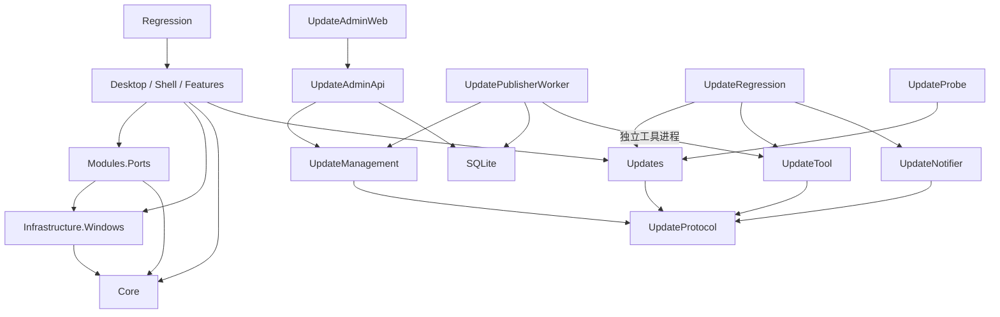

# 当前工程架构

更新日期：2026-10-25。桌面端与管理网站位于同一仓库，应用、构建及部署独立。

更新模块的使用和部署见 [自动更新操作说明](AUTO-UPDATE.md)。协议库、发布工具、通知服务及独立验证项目已落地，正式部署另行执行。实施计划与验证过程记录保存在本地 `.local/docs/`，不随源码分发。

## 项目依赖

十一个生产项目，其中新增 UpdateManagement、UpdateAdmin.Api 和 UpdatePublisher.Worker。Core、Windows、Ports、Updates、UpdateProtocol、UpdateTool 和 UpdateNotifier 均不引用 Avalonia、CommunityToolkit 或桌面宿主。开发验证包括 Regression、UpdateRegression、UpdateAdmin.Tests 和不随正式版本分发的 UpdateProbe。保留既有公开类型命名空间，将程序集拆分与命名空间改名分开处理。

| 项目 | 当前职责 |
|---|---|
| Core | SystemProtection、ProcessSnapshotItem、ProcessIdentity、ProcessMetadata、名称服务契约、DiagnosticLog、OperationLog |
| Infrastructure.Windows | 公共 NativeMethods/NativeStructs、进程身份与应用名称缓存、权限、提权、单实例、开机启动、系统偏好 |
| Modules.Ports | 纯快照、报告、采集与重置接口、扫描队列、释放复检、进程操作及 HTTP.sys 诊断 |
| Updates | Configuration、Domain、Protocol、Serialization、Application、Persistence、Installation、Diagnostics；HTTP 策略和发布信任状态均封装在此模块 |
| UpdateProtocol | DTO、源生成 JSON、签名/同源/有效期验证和版本包结构验证；客户端与服务端共用 |
| UpdateTool | ZIP/EXE 自检、排他锁、CAS、不可变包、原子清单、回执恢复与公网复检 |
| UpdateNotifier | ASP.NET Core loopback 服务、有效清单监测、有界 SSE 广播及健康信息 |
| UpdateManagement | 管理契约、认证、持久任务、上传封存、发布及下载检查编排、当前版本聚合 |
| UpdateAdmin.Api | 受认证的管理 HTTP 接口、只读正式清单查询及离线运维入口 |
| UpdatePublisher.Worker | 独立领取验证、激活和下载检查任务，调用固定配置的 UpdateTool |
| Desktop | Bootstrap、Shell、Features、Configuration、Presentation、Diagnostics、Assets |

公共进程原生声明进入 Windows；仍与端口复检和连接操作关联的 ProcessManagerService 暂留 Ports。出现第二个实际消费者后再抽取通用操作接口，Windows 不反向依赖 Ports。

## 数据与装配

采集返回无 UI 通知的 PortConnection。Desktop 的 PortConnectionItem 增加勾选、焦点、通知和样式，归并时复用现有显示行，只为新增行转换快照。ProcessTreeNode 与 ProcessTreeNodeViewModel 分开承担数据和 Avalonia.Thickness。

快照暂保留原始 TCP 数值与状态字段，以维持 SetTcpEntry 参数兼容；它们不引用原生结构或 UI 框架，后续可在适配边界后继续隐藏。

Bootstrap/ApplicationComposition 显式装配依赖。PortToolServices 保证刷新和释放复检使用同一 ScanCoordinator；协调器依赖 IPortScanner，释放依赖 ITcpConnectionResetter，现有测试派生类仍可注入。

应用名称与真实进程名独立保存。WindowsProcessMetadataProvider 按 PID + 创建时间关联进程实例，两个后台消费者通过有界通道读取文件描述/产品名称，并按文件路径及时间/大小缓存；进程查询在扫描线程执行，输入和布局不读取进程或文件。每个消费者拥有独立 Session，退出时释放自己的需求；Bootstrap 可注入共享服务，供未来任务管理器复用。名称快照不可变，变化通知按小批次合并，网络指纹不变时也能更新界面。

Desktop/Features/Ports/Services 承担名称关联和筛选排序。生产搜索由单一后台消费者处理，只保留最新请求并校验版本，UI 线程归并显示行；交互期间的后台结构调整继续经过静默闸口。ConnectionRowCache 复用当前网络快照中暂被过滤的显示行，连接退出或创建时间变化时清理；隐藏行解除事件订阅并清除选择，恢复搜索不带回旧选择。

Program 设置 Core.DiagnosticLog 和 Updates.UpdateLog 的日志出口，底层不再调用 App.WriteLog。更新安装/恢复仍先于 UI、单实例及提权初始化；健康确认仍在原有工作区初始化成功后，未提前到空 Shell 出现时。

## 页面与扩展

PortsView、KernelDiagnosticsView、SettingsView 已提取为独立 UserControl。Shell 保留标题栏、导航、详情、确认弹窗和托盘。部分复杂列表事件仍由页面显式桥接到宿主，以保持现有行为。

Shell 内的系统保护拦截、家族终止、退出确认弹窗共用 `Presentation/Styles/ConfirmationDialogs.axaml`：圆角卡片、主题化描边与阴影、独立标题/正文/操作区和等宽按钮。Shell 负责模态焦点、键盘循环及快捷键隔离；原有 MainViewModel 命令与终止服务继续执行风险、保护进程和重复操作校验。增加同类确认界面时可复用呈现样式，不将业务操作塞进通用弹窗服务。应用更新仍按独立原型采用 `Features/Updates` 下的窗口、ViewModel 和局部主题，重启确认在该窗口内完成。

Updates 功能的 UI 状态来自更新模块的 UpdateSnapshot，不通过中文状态字符串推断阶段。Shell 仅管理窗口生命周期、主操作保护与保存设置后调用安装器；新状态和界面逻辑不扩张 MainViewModel。配置新增 AutoCheckForUpdates，旧配置默认开启。详见 UPDATE-UI-DESIGN.md。

ShellViewModel 根据静态 ToolRegistration 生成导航。现有入口保留 LegacyIndex 兼容映射；新工具用唯一 ID 和显式 ViewFactory，首次选择时创建页面并复用。独立 VM 可通过 IToolPageLifecycle 和 IDisposable 管理资源。

导航选中标题和主图标使用 AccentFg 动态主题资源，数量徽标保留辅助色。端口表新增应用名称列（逻辑 ID 7），原列 ID 0～6 不变；应用名称和进程名分别显示与排序。表头和数据行共享列定义并同步水平偏移，纵向继续使用固定 48px 行高的视口虚拟化。

MainViewModel.* 位于 Shell/Compatibility，仍是已有功能的兼容协调层，尚未全部拆成独立设置、更新和端口 VM。新增工具不得扩张它。没有预建空的未来模块，也未引入动态插件框架。

## 配置及验证

### 管理后台契约边界

管理 API、Publisher Worker 和 UpdateManagement 是独立于桌面的宿主与业务模块；Vue 位于 `src/Web/PortKiller.UpdateAdmin.Web`。管理侧上传、校验和发布状态不复用客户端 UpdateSnapshot。

管理 API 使用 `/api/v1`、camelCase JSON 和字符串枚举；分页统一为 page/pageSize/total/items。错误使用 Problem Details，并附稳定 code 和 correlationId，不返回堆栈或运行目录。`/health/live` 仅提供存活信息，管理接口默认需要认证。

`deploy/contracts/admin-api.v1.json` 由实际 API 导出；前端类型通过 openapi-typescript 生成，构建检查需比较实际契约及已生成类型。新增业务入口随对应功能任务加入契约，不将规划中的接口伪装为已经实现。

管理数据位于独立 DataRoot 中的 SQLite，使用 EF Core 10 迁移、WAL、外键、短写事务和应用并发版本；认证由 ASP.NET Core Identity、持久 Data Protection 和数据库会话共同实现。密码仅进入受限认证阶段，完成 TOTP 及恢复码确认后才获得业务权限。每次请求重新核对账号、安全版本、会话撤销和期限，长连接可调用无跟踪的新鲜会话检查。Viewer/Uploader/Publisher/Administrator 的权限由服务端生成；敏感操作在短写事务内再次验证有效会话、管理员角色及近期强认证。

安全变更与成功审计在同一事务提交；失败和拒绝请求在响应头发出前独立记录。审计只接受有界操作标识、资源 ID、账号 ID、结果、UTC 时间、可信远端地址和关联 ID，不接受请求体、查询串或异常正文。读取要求 audit.read 权限并有分页上限；默认保留 90 天且最多 100000 条，单次清理不超过 500 条。预期认证失败及内部异常均由统一处理器返回安全错误，日志只记录关联 ID 和异常类型。

API/Worker 在运行期持有同一数据根的共享维护锁并检查迁移版本；维护命令持有排他锁，锁探测不生效时拒绝继续。在线备份通过 SQLite BackupDatabase 捕获包含 WAL 已提交写入的一致快照，同时保存认证密钥及摘要。恢复必须停机，先验证暂存副本，再撤销恢复出的全部会话并原子替换数据库，保留替换前的数据库和已有认证密钥。管理数据库恢复不替代公开清单、不可变包及发布回执的一致性核对，完整发布恢复由后续阶段完成。

上传 API 只接受 `application/octet-stream` 的清单包络和 ZIP 两个流，服务端分配随机 StorageId，客户端不可指定文件名或磁盘路径。活动会话按账号及服务总量预留容量；Kestrel 请求体限制依据该会话预留值设置，应用另以固定 64 KiB 缓冲读取实际字节、增量计算 SHA-256 和精确核对长度。单会话文件锁串行接收、完成与取消，失败会删除临时文件；文件和摘要均核对后会话才转成 Uploaded。Worker 领取持久验证任务，将文件封存到自身控制的 archive 目录，严格验签和验包成功后记录 ReadyForApproval。API 不静态公开这些私有文件。

UpdateTool 通过固定路径及 ArgumentList 调用，支持可选 `--json-errors`、schema=1 的 code/message 错误封套。单次确认绑定产物摘要和正式清单基线，Worker 激活前再次核对摘要，工具在原有提交锁内执行 CAS 和原子清单切换。API 只读取正式签名清单，私钥留在 Windows 制作环境。

发布执行同时受本地执行锁和数据库租约保护，心跳使用独立 DbContext；租约丢失时取消并终止工具。工具通过可选父进程 PID、启动时间和运行时限防止孤儿进程继续提交，并在服务端提交锁内再次检查。恢复先验证当前清单和实际包、修复回执，再修复数据库；匹配已确认摘要时恢复 ManifestActivated，较新的可信发布使旧任务变为 Superseded，无法核对时保留 Publishing。实际激活才消耗尝试次数，耗尽后仍先核对是否已经提交。原 CLI 不带父进程参数时继续使用原流程和同一提交锁。

下载检查使用独立领取器、执行器、尝试次数和结果字段。状态从 ManifestActivated 进入 PublicVerifying，再进入 Completed 或 ActiveUnverified；检查取消或租约过期后只重新检查，较新正式版本使旧任务成为 Superseded。60 秒租约由独立 DbContext 每 20 秒续租，共用本地发布执行锁。检查前后均通过只读 inspect 核对清单及实际包，检查结果绑定确认时的清单和包摘要，避免长下载期间版本切换导致误报。

`public-check` 只使用部署验签配置中的清单 URL 和签名清单中的同源包 URL，拒绝重定向，限制清单及包大小，严格验签、验包并核对单字节 Range。独立的 1–600 秒总超时默认 300 秒，取消令牌覆盖响应头、响应体及写入；外层进程时限和父进程监视负责终止遗留工具。原任务的检查重试要求发布权限、资源归属、近期 MFA、CSRF 和审计，重复请求幂等，不能传 URL 或转回激活状态。

`GET /api/v1/releases/current` 仅从正式签名清单和管理数据库聚合版本、签名到期状态、历史激活回执摘要及最近下载检查。清单观察时间、回执记录时间和检查完成时间分别返回；查询不联网、不读取或修复 Worker 私有回执文件，历史成功不表示当前公网健康。外部 CLI 发布没有匹配后台任务时，回执和检查均为空。14/7/0 天阈值分别用于到期预警、严重预警和已过期提示；签名结构有效但已过期的清单仍可查询，损坏或无法核对的源返回 503。当前验收使用 Windows 本机 HTTP 服务和隔离签名产物，真实 Linux、Nginx、HTTPS 和公网路径留到 P7–P8。

任务事件统一由 JobEventJournal 在状态变更的同一事务内追加。ReleaseJob.LastEventSequence 独立于保留行，升级迁移从已有 JobEvents 回填；事件号为每任务单调递增的 64 位整数，对外使用含任务 ID 的字符串。事件只接受有界阶段和结果标识，写入失败使状态、事件号和事件一起回滚。按时间索引清理，默认每任务 500 条、全库 100000 条、30 天保留；追加及每小时维护执行清理，读取同时检查逻辑保留期限及连续性。

`/api/v1/jobs/{id}` 返回 validate/publish 的一致快照，`/events` 使用游标分批补读，`/events/stream` 提供受同源 Cookie 保护的管理 SSE。JobEventQuery 在 SQLite WAL 的短暂延迟读事务内检查新鲜会话、当前角色及任务归属，读取状态、事件水位和至多 100 条事件。无游标或历史缺失时重置到最新快照，SSE 每批至多 32 条。阶段事件携带 SSE ID，普通快照不推进 SSE ID，首次或 reset 快照才把游标定位到当前水位；Last-Event-ID 优先于 URL 的初始游标。快照表示当前状态，历史事件仅供阶段展示。

JobEventStream 每批读取使用独立作用域，网络写入前释放 DbContext 和读事务，以有界数据库补读替代无限广播队列。默认每 500ms 重新检查会话、角色、归属及状态，10s 心跳、5s 批次写时限、600s 连接轮换；每 API 进程最多 100 连接、每账号 5 连接，账号限额覆盖其全部会话。慢写、客户端断开及宿主停止均释放配额；过期、撤销或权限失效发送 closed 并关闭。心跳不刷新 LastSeen；管理 SSE 与独立的公开 UpdateNotifier SSE 分开授权和部署。本阶段可在 Windows 本机 Kestrel 的临时自签名 HTTPS 下验证，真实 Linux/Nginx/生产证书路径留待 P7–P8。

用户 config.json、更新信任配置、注册表键、互斥体、EXE 名称与版本保持兼容。SettingsJsonContext 和 UpdateJsonContext 继续用于 AOT 序列化。

ColumnSettingsMigrator 在读取规范化阶段将 7 项列配置幂等迁移到 8 项，逐字段保留合法列宽、列序和可见性，补入默认显示的应用名称列。异常列宽和重复/越界 ID 分别修复，现有原子保存流程负责持久化。

应用名称独立回归入口支持 `--application-name-ui` 和 `--application-name-probe 秒数 输出路径`；后者不启动托盘、不修改用户设置、不结束用户进程。修改方案和验证记录分别归档在本地 `.local/docs/plans/` 和 `.local/docs/reports/`。

构建与验证入口见根 [README](../README.md)。源码、测试、脚本和部署示例保留原目录；公开文档仅维护本架构说明、自动更新操作说明和发布说明。本地文档、缓存、构建产物、配置和临时文件集中在 `.local/` 并分类存放，整个目录忽略提交。SDK/IDE 管理的 `bin/obj`、`.vs` 等保留默认位置。

构建和验证产物默认写入 `.local/artifacts/`；本地发布配置位于 `.local/config/publisher.local.json`，非敏感示例位于 `deploy/examples/`。历史调查、迁移和验证过程统一归档在 `.local/docs/reports/`，历史结果不代替当前验证。
