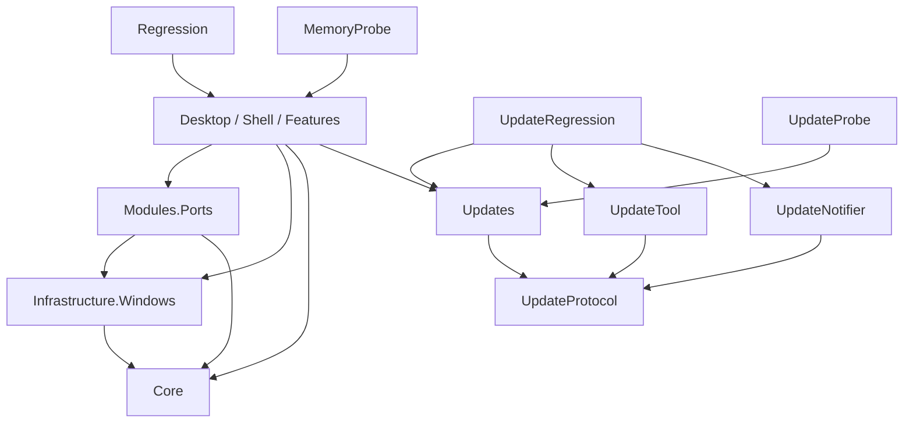

# 当前工程架构

更新日期：2026-10-24。根目录：`C:\自用\项目\PortKill`。

更新模块的实现依据见 [自动更新架构规划](AUTO-UPDATE-ARCHITECTURE-PLAN.md)，实际状态见 [操作说明](AUTO-UPDATE.md) 和 [验证记录](AUTO-UPDATE-VALIDATION.md)。协议库、发布工具、通知服务及独立验证项目已落地，正式部署另行执行。

## 项目依赖

八个生产项目。Core、Windows、Ports、Updates、UpdateProtocol、UpdateTool 和 UpdateNotifier 均不引用 Avalonia、CommunityToolkit 或桌面宿主。开发验证包括 Regression、MemoryProbe、UpdateRegression 和不随正式版本分发的 UpdateProbe。保留既有公开类型命名空间，将程序集拆分与命名空间改名分开处理。

| 项目 | 当前职责 |
|---|---|
| Core | SystemProtection、ProcessSnapshotItem、ProcessIdentity、ProcessMetadata、名称服务契约、DiagnosticLog、OperationLog |
| Infrastructure.Windows | 公共 NativeMethods/NativeStructs、进程身份与应用名称缓存、权限、提权、单实例、开机启动、系统偏好 |
| Modules.Ports | 纯快照、报告、采集与重置接口、扫描队列、释放复检、进程操作及 HTTP.sys 诊断 |
| Updates | Configuration、Domain、Protocol、Serialization、Application、Persistence、Installation、Diagnostics；HTTP 策略和发布信任状态均封装在此模块 |
| UpdateProtocol | DTO、源生成 JSON、签名/同源/有效期验证和版本包结构验证；客户端与服务端共用 |
| UpdateTool | ZIP/EXE 自检、排他锁、CAS、不可变包、原子清单、回执恢复与公网复检 |
| UpdateNotifier | ASP.NET Core loopback 服务、有效清单监测、有界 SSE 广播及健康信息 |
| Desktop | Bootstrap、Shell、Features、Configuration、Presentation、Diagnostics、Assets |

公共进程原生声明进入 Windows；仍与端口复检和连接操作关联的 ProcessManagerService 暂留 Ports。出现第二个实际消费者后再抽取通用操作接口，Windows 不反向依赖 Ports。

## 数据与装配

采集返回无 UI 通知的 PortConnection。Desktop 的 PortConnectionItem 增加勾选、焦点、通知和样式，归并时复用现有显示行，只为新增行转换快照。ProcessTreeNode 与 ProcessTreeNodeViewModel 分开承担数据和 Avalonia.Thickness。

快照暂保留原始 TCP 数值与状态字段，以维持 SetTcpEntry 参数兼容；它们不引用原生结构或 UI 框架，后续可在适配边界后继续隐藏。

Bootstrap/ApplicationComposition 显式装配依赖。PortToolServices 保证刷新和释放复检使用同一 ScanCoordinator；协调器依赖 IPortScanner，释放依赖 ITcpConnectionResetter，现有测试派生类仍可注入。

应用名称与真实进程名独立保存。WindowsProcessMetadataProvider 按 PID + 创建时间关联进程实例，两个后台消费者通过有界通道读取文件描述/产品名称，并按文件路径及时间/大小缓存；进程查询在扫描线程执行，输入和布局不读取进程或文件。每个消费者拥有独立 Session，退出时释放自己的需求；Bootstrap 可注入共享服务，供未来任务管理器复用。名称快照不可变，变化通知按小批次合并，网络指纹不变时也能更新界面。

Desktop/Features/Ports/Services 承担名称关联和筛选排序。生产搜索由单一后台消费者处理，只保留最新请求并校验版本，UI 线程归并显示行；交互期间的后台结构调整继续经过静默闸口。ConnectionRowCache 复用当前网络快照中暂被过滤的显示行，连接退出或创建时间变化时清理；隐藏行解除事件订阅并清除选择，恢复搜索不带回旧选择。

Program 设置 Core.DiagnosticLog 和 Updates.UpdateLog 的日志出口，底层不再调用 App.WriteLog。更新安装/恢复仍先于 UI、单实例及提权初始化；健康确认仍在原有工作区初始化成功后，未提前到空 Shell 出现时。

## 页面与扩展

PortsView、KernelDiagnosticsView、SettingsView 已提取为独立 UserControl。Shell 保留标题栏、导航、详情、确认弹窗和托盘。部分复杂列表事件仍由页面显式桥接到宿主，以保持现有行为。

Shell 内的系统保护拦截、家族终止、退出确认弹窗共用 `Presentation/Styles/ConfirmationDialogs.axaml`：圆角卡片、主题化描边与阴影、独立标题/正文/操作区和等宽按钮。Shell 负责模态焦点、键盘循环及快捷键隔离；原有 MainViewModel 命令与终止服务继续执行风险、保护进程和重复操作校验。增加同类确认界面时可复用呈现样式，不将业务操作塞进通用弹窗服务。应用更新仍按独立原型采用 `Features/Updates` 下的窗口、ViewModel 和局部主题，重启确认在该窗口内完成。

Updates 功能的 UI 状态来自更新模块的 UpdateSnapshot，不通过中文状态字符串推断阶段。Shell 仅管理窗口生命周期、主操作保护与保存设置后调用安装器；新状态和界面逻辑不扩张 MainViewModel。配置新增 AutoCheckForUpdates，旧配置默认开启。详见 UPDATE-UI-DESIGN.md。

ShellViewModel 根据静态 ToolRegistration 生成导航。现有入口保留 LegacyIndex 兼容映射；新工具用唯一 ID 和显式 ViewFactory，首次选择时创建页面并复用。独立 VM 可通过 IToolPageLifecycle 和 IDisposable 管理资源。

导航选中标题和主图标使用 AccentFg 动态主题资源，数量徽标保留辅助色。端口表新增应用名称列（逻辑 ID 7），原列 ID 0～6 不变；应用名称和进程名分别显示与排序。表头和数据行共享列定义并同步水平偏移，纵向继续使用固定 48px 行高的视口虚拟化。

MainViewModel.* 位于 Shell/Compatibility，仍是已有功能的兼容协调层，尚未全部拆成独立设置、更新和端口 VM。新增工具不得扩张它。没有预建空的未来模块，也未引入动态插件框架。

## 配置及验证

用户 config.json、更新信任配置、注册表键、互斥体、EXE 名称与版本保持兼容。SettingsJsonContext 和 UpdateJsonContext 继续用于 AOT 序列化。

ColumnSettingsMigrator 在读取规范化阶段将 7 项列配置幂等迁移到 8 项，逐字段保留合法列宽、列序和可见性，补入默认显示的应用名称列。异常列宽和重复/越界 ID 分别修复，现有原子保存流程负责持久化。

应用名称功能与性能检查见 [修改方案](APP-NAME-SEARCH-NAV-PLAN.md) 和 [验证记录](APP-NAME-SEARCH-NAV-VALIDATION.md)。独立回归入口支持 `--application-name-ui` 和 `--application-name-probe 秒数 输出路径`；后者不启动托盘、不修改用户设置、不结束用户进程。

构建与验证入口见根 README，实际结果和限制见 migration/EXECUTION.md。历史调查在 investigations 下，历史记录不代替本次验证。
