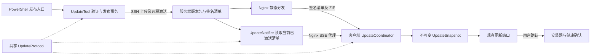

# 自动更新补齐与实时发布架构规划

日期：2026-10-24。状态：实现已落地，完整本地自动化验收及补充权限用例通过。本文保留设计依据和验收目标；实际实现、验证结果及未覆盖的现场条件以 [验证记录](AUTO-UPDATE-VALIDATION.md) 和 [操作说明](AUTO-UPDATE.md) 为准，不代表已部署生产服务器。

对应范围：修复连续版本状态、发布恢复与并发、首次安装包、实时通知、后台执行、真实 AOT 升级验证及运行记录。现有行为基线见 [AUTO-UPDATE.md](AUTO-UPDATE.md)。

落地说明：客户端仍在 UpdateService 内保留已验证的清单/下载实现，通过后台入口、单飞锁和独立协调器划分职责，没有为了文件落点复制两套传输代码。ReleaseIdentity 与 PreparedUpdate 同文件定义。发布记录采用 Created → Verified → Staged → ManifestActivated → PublicVerified → Completed，服务端持久事务覆盖包发布与清单切换两个提交点。构建版本由参数与发布记录确定，源项目版本不自动改写；缺省版本同时参考服务端当前版本。阶段 F 已提供可复用验证/发布脚本，外部 CI 平台、密钥托管与生产接入尚未配置。

## 1. 架构目标和约束

- 在线客户端在发布后及时发现新版，下载和重启仍由用户确认。
- 发布失败可以判断实际进度，并使用同一份已签名产物恢复；并发发布不能使服务端版本或序号倒退。
- 检查、验签、缓存处理和发布操作在后台执行，UI 只消费不可变快照。
- 兼容已有 schema 2 签名清单、四文件 ZIP、客户端配置和更新信任记录。
- 继续使用文件事务、SSH 上传和静态文件分发。当前单机部署规模采用单个通知服务，无需数据库或消息队列；多节点扩展另行评估。
- 既有客户端先通过原轮询升级到支持通知的新客户端。缺少推送服务时，新客户端继续轮询。
- 本次不扩展为静默安装、倒计时重启或界面热更新。现有更新窗口尺寸和视觉样式继续使用。

## 2. 现状与需要闭合的问题

| 范围 | 已有能力 | 本次补齐 |
|---|---|---|
| 版本发现 | 启动后延迟检查、300–330 秒轮询、手动 30 秒节流 | SSE、网络恢复/休眠唤醒补查、统一调度、忙时保留检查意图 |
| 下载 | 流式下载、暂停、Range 续传、有限重试、摘要检查 | 后台执行边界、版本身份一致、明确下载中收到新版通知的处理 |
| 更新状态 | Available、Ready、ReadyPackage 等独立字段 | 不可变目标记录、旧就绪包失效、304 与安装目标一致 |
| 发布 | 构建、签名、SSH/SCP、先包后清单、单文件原子替换 | 发布前自检、本地/服务端锁、持久状态、比较后激活、可恢复重试 |
| 首装 | 发布脚本可以生成更新配置 | 完整首装 ZIP、配置自检、版本化的非敏感模板 |
| 安装 | 工作副本、复检、备份、事务日志、健康确认与回滚 | 两个真实 AOT 版本的端到端验证和故障矩阵 |
| 运维 | 错误日志、Nginx 请求日志 | 阶段记录、发布回执、到期检查、耗时测量和恢复手册 |

确认的代码问题：新清单赋给 Available 时没有失效旧 Ready；HTTPS 的 304 分支优先返回旧 Ready。发布脚本在版本 ZIP 已存在时直接失败，缺少事务恢复入口；签名私钥与首装配置公钥也没有配对验证。以上应在扩展通知之前修复。

## 3. 总体结构与项目边界



### 3.1 项目职责

| 项目 | 决策 |
|---|---|
| `src/Modules/PortKiller.UpdateProtocol`，新增 | 跨平台协议库：清单 DTO、签名验证、版本归一化、平台/同源/有效期约束、验证结果和源生成 JSON 上下文。客户端、工具、通知服务共同引用 |
| `src/Modules/PortKiller.Updates`，现有 | 客户端更新配置、协调、传输、缓存、信任记录、安装事务和日志；引用协议库，不依赖 Avalonia |
| `src/Tools/PortKiller.UpdateTool`，新增 | 跨平台控制台工具：发布自检、服务端激活/恢复/状态查询、发布回执；引用协议库，不引用 Desktop 或 Windows 安装器 |
| `src/Services/PortKiller.UpdateNotifier`，新增 | .NET 10 ASP.NET Core Minimal API，只提供版本通知和运行健康状态；引用协议库，不负责签名或替换客户端文件 |
| `PortKiller.Desktop`，现有 | 在 Bootstrap 装配更新服务和系统事件适配，保持更新窗口及安装确认职责 |
| `tests/PortKiller.UpdateRegression`，新增 | 跨平台协议、发布事务、通知和调度验证，不依赖 Desktop，可在 Linux 执行 |
| `tests/PortKiller.Regression`，现有 | 保留现有回归入口和 UI/宿主集成验证，逐步把跨平台更新用例迁入新测试项目，避免重复执行 |

抽取协议库是为了让三个实际消费者使用同一验签规则。保留已有公共 DTO 的命名空间和清单 JSON 字段名；改变内部方法入口时同步调整调用点与测试，不同时重命名整个更新模块。

服务端首版按 `linux-x64` 自包含、非 AOT 方式发布，不依赖 Windows C++ 工具链。Windows 客户端继续保持 `win-x64 Native AOT`；如目标服务器是 ARM64，另生成匹配 RID 的服务端包。生产服务器不安装开发 SDK。

### 3.2 客户端文件落点

```text
PortKiller.Updates/
  Application/
    UpdateService.cs              对外兼容入口和服务生命周期
    UpdateCoordinator.cs          后台调度、检查意图、任务完成归并
  Domain/
    ReleaseIdentity.cs            归一化版本、序号、payload 摘要、包摘要
    PreparedUpdate.cs             已验证清单、包路径及身份的一致记录
    UpdateSnapshot.cs             UI 可见状态与错误
  Transport/
    ManifestClient.cs             小型清单读取、条件请求和响应校验
    PackageDownloader.cs          下载、暂停、续传、重试和进度
    UpdateEventClient.cs          有界 SSE 解析、连接与重连
  Persistence/
    UpdateTrustStore.cs           最高已验证发布记录
    UpdatePackageCache.cs         验证缓存和有界清理
  Installation/
    UpdateInstaller.cs            既有安装/恢复事务
  Diagnostics/
    UpdateOperationLog.cs          阶段事件和耗时
```

以上是职责落点；按阶段移动现有实现，避免一次性复制两套下载或安装流程。通过已有依赖注入方式装配 HTTP、时间、网络/唤醒信号与日志，便于确定性测试，不建立通用插件框架。

## 4. 客户端调度和状态契约

### 4.1 一套后台协调入口

启动检查、轮询、手动操作、推送、网络恢复和休眠唤醒统一提交给 UpdateCoordinator。协调任务运行在后台；网络、文件及密码学操作不捕获 Avalonia 同步上下文，快照由 Desktop 现有合并逻辑送至 UI。

检查触发只保留一次待执行意图，并合并原因；触发数量不会线性增加队列。用户下载、暂停和安装操作具有明确结果，不通过丢弃旧消息的检查队列处理。

下载是协调器管理的可取消子任务。协调循环不能等待整次下载而无法接收暂停；暂停立即发出取消信号，任务完成结果携带 generation，旧任务结果不能覆盖新状态。

| 触发 | 调度规则 |
|---|---|
| 首次启动 | 保留初始化完成后约 10–15 秒延迟；启动检查完成后建立 SSE，并用连接时当前版本通知覆盖间隙 |
| 定时轮询 | 保留默认 300 秒及抖动；推送可用时也持续兜底 |
| 手动检查 | 保留 30 秒防连点，明确显示等待原因 |
| SSE 新提示 | 合并重复事件，最小检查间隔暂定 2 秒，增加 0–500ms 随机延迟；在线单次正常发布以 5 秒 P95 为验收目标 |
| 网络恢复、唤醒、重新打开自动检查 | 提交一次补查并恢复 SSE，合并短时间连续系统信号 |
| 正在检查/下载/校验 | 保留一次待检查意图，当前阶段结束后执行；不丢失新版提示 |
| 安装确认/安装准备 | 暂缓检查，锁定已确认安装目标；取消确认或准备失败后处理待检查意图 |

把手动冷却、短间隔通知合并和服务端 `Retry-After` 分别记录。所有触发都必须遵守服务端退避；待执行检查在退避到期后重新唤醒，不能用推送绕过服务器要求。

自动检查关闭后停止 SSE 与自动补查，手动入口保留。窗口隐藏不影响服务，应用退出时统一取消、等待后台任务结束并解除系统事件订阅。

### 4.2 版本和更新包必须一致

- `ReleaseIdentity` 同时标识归一化版本、签名发布序号、原始 payload 摘要和 ZIP 摘要。原始签名数据不能在验签前规范化或重序列化。
- `PreparedUpdate` 将已验证清单、包路径和身份作为一个不可变记录发布；避免 Ready 与 ReadyPackage 分别赋值产生分离状态。
- 发现更高版本 B 后，旧版本 A 的就绪记录从当前安装目标中失效；旧 ZIP 可留作有界缓存，但不能继续呈现为当前可安装目标。
- 304 只复用本次条件请求对应的已验证清单；只有准备好的包匹配该清单身份且仍有效，才能显示 Ready。
- 同一版本、同一 ZIP 用更高序号续签时，重新验证清单并复用已验证包；更新说明刷新，但不重复提示为新的应用版本。
- 用户确认安装时取得安装目标租约，冻结目标，并阻止新的检查推进本机信任序号直到安装交接完成。缓存文件仍由安装器再次验证。
- 暂停下载时保留检查意图，在继续下载或用户明确取消暂停后再处理，不由后台检查自动恢复下载。继续时先复核清单有效期；无效时提示重新检查。

用例至少覆盖：A 就绪后发现 B、B 未下载时收到 304、B 下载失败、清单续签、安装确认时收到 B、旧异步任务晚到。界面、设置页安装按钮和安装器必须引用同一目标身份。

### 4.3 性能执行边界

- 网络与 ZIP 使用流式处理；清单和事件解析有大小上限。
- 验签、缓存 hash、信任记录及清理全部在后台执行。大包校验和安装准备不进入 UI 回调。
- 保持约 200ms 进度节流、最新快照合并和局部属性通知。新通知状态不引起整页重建。
- 相同清单已验证且信任记录未变化时避免无意义磁盘重写；包校验缓存必须绑定文件身份/长度/修改时间和包摘要，缓存变化后重新计算。
- 不在每个下载进度事件写磁盘日志。只记录阶段边界和汇总。

## 5. SSE 协议和通知服务

### 5.1 公开协议

新增同源 `GET /stable/events`。通知只含版本提示，不下发安装命令、公钥、包下载地址或本机路径。

```text
id: 1790000001
event: release
data: {"schema":1,"channel":"stable","version":"0.1.1","sequence":1790000001}

```

提示内容视为不可信输入：不能据此修改信任记录、安装包或界面版本。客户端重新获取并验证 schema 2 签名清单后才更新状态。事件序号不能直接成为“已接受发布序号”，防止伪造提示阻断后续正常事件。

| 项目 | 初始设计值 |
|---|---|
| 响应 | `Content-Type: text/event-stream`，禁用缓存和代理缓冲 |
| 心跳 | 每 25 秒发送注释心跳，不触发清单检查 |
| 单行 / 单事件上限 | 4 KiB / 8 KiB，超限断开并退避 |
| 建连 / 响应头超时 | 连接 5 秒、响应头 8 秒；流连接不套用整次清单请求超时 |
| 无消息超时 | 75 秒没有有效事件或心跳则重连 |
| 重连 | 指数退避加抖动，约 1 秒至 60 秒；服从服务端 Retry-After |
| 不支持 SSE | 404/405/501 时降级轮询，约 30 分钟后探测；401/403 记录配置问题并降低探测频率 |
| 连接恢复 | 服务端立即发送当前已激活版本提示，客户端按已验证状态决定是否补查 |

以上是实现初值，需负载验证后固化。客户端使用 HttpClient 流读取，不能依赖浏览器 EventSource 自动重连行为。解析支持 CRLF、多行 data、注释及标准事件边界，并通过源生成 JSON 保持 AOT 兼容。

### 5.2 服务端实现

UpdateNotifier 以独立低权限 systemd 服务运行，只监听 loopback，由 Nginx 代理公开事件路由。管理操作仍经 SSH 执行 UpdateTool，不公开激活 HTTP API。

通知源是公开目录中**已经原子切换的签名清单**。服务启动时验签读取当前清单；FileSystemWatcher 用于快速唤醒，约 1 秒一次的轻量文件身份检查用于弥补监听遗漏，内容未改变时不重复解析或验签。

检测到变化后先验证签名和单调性，再原子更新内存中的当前提示并广播。临时上传文件不触发通知。解析失败继续保留最后有效状态并报告健康异常，不能广播半成品。服务重启、通知丢失或发布进程在清单切换后崩溃，都可从当前清单恢复。

每个连接仅保留一个最新提示，慢客户端不累积历史版本队列；写入超时即断开。只保存当前激活版本，不保存客户端业务数据或历史事件流。

Nginx 增加精确的 events 路由，关闭代理缓冲与事件流压缩，并配置超过心跳间隔的读取超时。静态清单继续 no-cache，版本包继续 immutable。

## 6. 可恢复发布架构

### 6.1 本地不可变发布记录

发布入口仍是 `Publish-Update.ps1`，新增明确的恢复入口（建议 `-Resume <ReleaseId>`）。每次新发布使用唯一目录，不复用共享 AOT 输出目录。

```text
artifacts/releases/<ReleaseId>/
  publish/                         本次独立编译产物
  PortKiller-<Version>-win-x64.zip  供老客户端使用的四文件更新包
  PortKiller-<Version>-setup.zip    四文件及 update-settings.json 首装包
  manifest.json                    签名清单
  release-record.json              阶段、版本、序号、Git 提交、各摘要、公钥指纹
  server-receipt.json              服务器激活状态及清单摘要
```

记录中不保存私钥、SSH 密钥或口令。恢复同一 ReleaseId 不重新编译、不分配新序号、不改签名清单；若签名已过期或内容确需修改，应显式创建新的发布记录。

构建/签名前自检：工具链、版本格式和增长、发布说明、目标地址、首装配置、签名公私钥匹配，以及已有可信客户端使用的公钥指纹。签名后使用分发公钥复验完整清单，再检查 ZIP 长度/摘要/四文件结构与 EXE 版本。

正常发布使用干净工作区或明确记录脏工作区状态；CI 强制干净工作区并使用明确版本。Git 提交或 tag、构建版本、清单版本和产物摘要关联在同一记录中。

### 6.2 发布状态与恢复规则

```text
Created → Built → Verified → Staged → PackagePublished
        → ManifestActivated → PublicVerified → Completed
```

| 故障点 | 恢复规则 |
|---|---|
| 编译/签名未完成 | 保留失败记录，未公开内容可重新创建发布；不把缺文件目录作为可恢复已签名产物 |
| 上传中断 | 校验已有暂存文件，重新上传缺失或不完整文件 |
| ZIP 已公开，清单未切换 | 已有 ZIP 与记录长度/hash 相同则复用；不同则终止，禁止覆盖不可变包 |
| 清单已切换，SSH 回执丢失 | 查询服务端状态，匹配发布序号及清单摘要后继续公网验证 |
| 清单已切换，公网探测失败 | 标记已激活、待验证；不自动换回旧清单，不重建同版本产物 |
| 本地版本尚未写回 | 用服务器回执和发布记录核对后完成本地收尾，不重复发布 |

### 6.3 服务端原子激活

UpdateTool 在发布目录之外保存锁、状态和事务记录；上传暂存目录与最终目录同文件系统，保证 rename 原子切换。

激活流程：取得服务端排他锁 → 复核签名、版本、序号、有效期和包摘要 → 比较预期当前发布 → 安装/复用不可变 ZIP → 确认 ZIP 可读 → 原子替换清单 → 写入已激活记录和回执。

本地锁保护构建及序号文件；服务端锁与 compare-and-swap 保护多个发布机器。新序号大于本地计数和查询到的服务端序号，最终仍由激活时检查决定。服务端已变化则报告冲突，不能盲目覆盖或自动发布更旧版本。

清单切换是发布提交点。若此后进程崩溃，恢复工具从已签名公开清单核对并补齐记录。正式恢复旧代码使用更高版本及更高序号；不通过倒退 manifest 绕过客户端信任规则。

公网验证使用实际对外 URL，复核清单签名和摘要；冷发布演练还需完整下载 ZIP、验证长度/hash 和 Range。现有 localhost 返回 200 的探测不能代替这些检查。

### 6.4 可复现配置与长期兼容

- 在 `deploy/examples/` 放入无密钥的客户端/发布配置模板和发布说明样例；为这些明确文件增加最小 Git 忽略例外，不开放整个本地配置目录。
- 私钥、真实配置、发布记录和构建产物继续留在 Git 之外。私钥及序号文件需要独立备份；恢复发布机时与服务端序号核对。
- 发布地址改用单独的 `PublicBaseUrl`，SSH 主机和 HTTP 源分开配置，避免当前 HTTP+IPv4 的耦合；默认迁移保持旧 URL 有效。
- 增加清单续签入口：同一 ZIP、同一应用版本、更高序号和新有效期，不覆盖已发布 ZIP。通知客户端重验，但不重复提醒新应用版本。
- HTTPS、域名切换和公钥轮换单独采用兼容迁移。旧客户端不会因服务端文件变化而自动改变本地公钥或地址；不可直接关停旧源或替换公钥。自动公钥轮换不在第一版隐式引入，需要旧信任链授权的新协议和兼容发布顺序。

## 7. 配置与部署顺序

### 7.1 客户端兼容默认值

新增可选 `RealtimeEnabled`，在整个更新功能 Enabled 为 true 时默认启用；事件地址从 ManifestUrl 的目录派生为 `events`，可显式配置同源 EventsUrl。这样老的已启用配置也能接入通知，不要求四文件更新包覆盖配置。

保留现有 Enabled、AllowHttp、ManifestUrl、PublicKeyPem 及超时/轮询字段。整个更新未配置或 Disabled 时不建立任何更新连接。事件地址沿用同源、协议和无凭据/查询/片段限制。

通知服务不可用不应把正常的版本检查显示为更新失败；推送连接状态只写诊断信息，正式失败状态以清单检查、下载和安装结果为准。

### 7.2 上线次序

1. 在隔离环境验证新协议库及发布工具，保留老清单 URL 和 ZIP 格式。
2. 部署服务端激活工具、只读通知服务、systemd 配置和 Nginx events 路由；验证静态更新仍可用。
3. 通过旧更新链发布支持新调度/SSE 的客户端；老客户端仍使用轮询。
4. 完成真实两版本 AOT 升级及回滚演练，验证普通用户/管理员模式和安装目录权限。
5. 启用公网性能、过期和失败状态监测，再接入发布流水线。

通知服务独立故障可以停用其路由并让客户端降级轮询，静态更新源继续工作。

当前需要现场核实的外部条件：服务器发行版/CPU 架构、SSH 用户与权限、端口和安全组、实际首装客户端的更新地址与公钥、HTTPS/域名条件。这些影响最终部署参数，不阻塞本地模块和测试实现。

## 8. 安装验证、日志和维护

### 8.1 真实 AOT 演练

新增隔离安装测试入口，只使用临时安装目录、独立测试密钥、独立用户配置/信任目录，不操作正在使用的生产安装。现有固定配置路径需增加受控的测试依赖注入或专用测试宿主；生产运行不得接受更新清单指定本机配置路径。

至少构建两个不同版本的真实 win-x64 AOT 程序，验证主进程 → 工作副本 → 主进程退出 → 文件替换 → 新版本启动 → 健康确认整条链。

故障矩阵包括：新版未确认健康、替换中断、工作副本退出、安装目录不可写、磁盘空间不足、文件被锁定、普通/管理员运行和重复启动。杀毒软件或物理断电等需要实机演练，不能把模拟故障报告为实机验证。

每个用例核对四个文件摘要、进程版本、事务日志、设置保留和恢复后可启动性。保留原有 45 秒健康确认作为起点，依据真实慢机器数据再调整；不能把窗口首次显示当作完整初始化成功。

### 8.2 阶段日志与健康

记录 `OperationId / ReleaseId / Version / Sequence / Phase / DurationMs / Attempt / Failure`；客户端日志有大小或数量上限，不记录每个进度事件。

通知服务健康信息区分“进程运行”和“当前清单有效”，包含连接数、通知时间及当前已验证序号，不公开敏感管理能力。清单到期检查建议提前 14 天提示，7 天内升级处理；公网检测失败与签名失败分别记录。

首版不默认上传客户端诊断数据；阶段记录在本地导出，测试环境汇总延迟。后续集中遥测需另定数据范围。

### 8.3 验收目标

下列均为目标，需记录机器、RTT、包大小、吞吐和样本数后实测。

| 指标 | 初始验收目标与条件 |
|---|---|
| 推送发现新版 | P95 ≤ 5 秒；连接已建立、RTT ≤ 100ms、无服务端退避且未在下载/校验/暂停/安装阶段、正常单次发布，至少 100 次；繁忙时单独记录待检查耗时，不计入该目标 |
| 推送不可用时发现 | 保持原轮询能力；报告检查耗时及 300–330 秒等待，不承诺断网时固定上限 |
| 手动检查 | P95 ≤ 2 秒；未受节流/退避、正常网络，至少 100 次 |
| 下载期间交互 | 更新模块引起的 UI 线程执行片段 P95 ≤ 16ms，压力验证不出现超过 100ms 的相关阻塞 |
| 下载进度 | 传输稳态约每 200ms 合并一次，排队数量有界；阶段切换及时通知 |
| 空闲与连接 | 先以 1,000 个 SSE 连接进行阶梯压测，报告 CPU/RSS/断连率；不将该数字直接宣称为生产容量 |
| 发布恢复 | 每个提交点注入故障，恢复后清单、ZIP、回执一致；无坏包被公开引用 |
| 多客户端资源 | 连接队列、解析缓冲、重连与日志均有上限，长时间运行无持续增长 |

## 9. 分阶段实施清单

| 阶段 | 主要产物 | 依赖与完成条件 |
|---|---|---|
| A：正确性基础 | 协议库、旧 Ready 修复、PreparedUpdate/安装租约、后台调度基础、非敏感模板、签名公私钥自检 | 先运行现有回归；补 A/B/304、续签和并发确认用例；客户端 Native AOT 编译通过 |
| B：可靠发布 | UpdateTool、本地独立产物/首装包、事务记录、锁、恢复参数、服务端比较后激活、回执及公网检查 | 依赖 A；对每个发布提交点注入故障；重复执行同一产物成功，冲突版本明确拒绝 |
| C：真实安装闭环 | 隔离 AOT 测试宿主、两版本升级和故障矩阵、安装结果记录 | 依赖 A/B；在临时目录验证真实进程替换与健康确认，普通及管理员模式分别报告 |
| D：实时发现 | UpdateEventClient、UpdateNotifier、系统事件适配、Nginx/systemd 配置、SSE 协议回归 | 依赖 A/B，生产上线以前完成 C；断连、服务重启、事件丢失/重复/过大、Retry-After、自动开关测试通过 |
| E：运行验收 | 阶段日志、到期检查、压力/性能报告、恢复手册 | 依赖 B/C/D；区分实测与模拟，不能把构建成功等同于线上更新成功 |
| F：自动发布 | Windows 构建签名阶段、Linux 服务端测试/发布阶段、发布 tag/提交关联及产物保留 | 依赖 B/C/E；选定 CI 平台和签名密钥承载方式后实施，不把私钥放进仓库或公开产物 |

每个阶段单独提交，并更新实际验证记录。A～C 优先于正式启用推送；D 的开发可在发布事务测试稳定后推进。不得把 B 的发布幂等性、C 的真实安装或 D 的断线恢复留给生产用户首次发现。

## 10. 参考依据

- [ASP.NET Core Minimal API 响应及 ServerSentEvents](https://learn.microsoft.com/en-us/aspnet/core/fundamentals/minimal-apis/responses?view=aspnetcore-10.0)：通知服务的 .NET 10 实现入口。
- [Nginx proxy_buffering](https://nginx.org/en/docs/http/ngx_http_proxy_module.html#proxy_buffering)：事件流需要避免代理响应缓冲。
- [.NET Native AOT 部署](https://learn.microsoft.com/en-us/dotnet/core/deploying/native-aot/)：客户端继续按 AOT 序列化和发布约束验证。
