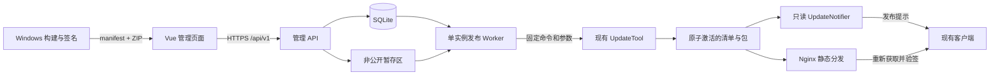

# PortKill 网页更新发布后台完整修改计划

日期：2026-10-24。

状态：待实施。本文件是当前方案的实施依据，不表示网页后台、认证、数据库或 Linux 部署已经完成。

仓库根目录：`C:\自用\项目\PortKill`。现有代码基线：`f10a601`。

本计划的编写不涉及业务代码或既有源码目录调整；网站后台仍需按以下阶段实施。

## 1. 已确认的目标

建设一个部署在 Linux 上的更新发布管理网站。管理员通过网站登录、上传已签名产物、查看校验结果和更新说明，再确认发布。现有客户端接收通知后，仍由用户决定下载和重启安装。

| 项目 | 确定方案 |
|---|---|
| 代码组织 | 单 Git 仓库，前后端源码均放在 PortKill 内 |
| 前端 | Vue 3、TypeScript、Vite；参考 Vue Vben Admin 的 Ant Design Vue 版本 |
| 后端 | ASP.NET Core 10 Web API，目标框架 `net10.0` |
| 后台任务 | 独立 .NET 10 Worker Service，单实例处理发布 |
| 数据存储 | SQLite，本地磁盘文件；EF Core 10 SQLite 提供程序 |
| 身份认证 | ASP.NET Core Identity、服务端可撤销的 Cookie 会话、强制 TOTP MFA |
| 网站部署 | Linux、Nginx、systemd；前后端分别构建，通过同一管理域名提供服务 |
| 更新分发 | 保留现有签名协议、UpdateTool、只读通知服务、静态下载与 Range |
| 签名位置 | Windows 本地或受保护的 Windows CI；网站不持有更新签名私钥 |
| 日常操作 | 提前生成签名产物，然后在网站完成上传、验证、确认和发布 |

EF Core 是程序依赖，不需要部署额外数据库服务。第一期不引入 PostgreSQL、Redis、消息队列或微服务集群。

## 2. 范围和兼容边界

### 2.1 第一期必须完成

- 单应用 PortKill、单渠道 stable、平台 win-x64。
- 成熟后台布局、浅色及深色主题、上传、任务进度、发布历史与审计。
- 本地账号、MFA、会话撤销、服务端权限校验和敏感操作再次认证。
- 上传一个签名清单和其对应的四文件更新 ZIP。
- 暂存、严格验证、绑定具体产物的发布确认、原子激活、公网验证及恢复。
- SQLite 持久任务和单发布 Worker，进程重启不会丢失发布结果。
- 只打包签名、不通过 SSH 直接激活的 Windows 产物准备入口。
- Linux 配置、安装升级、备份恢复、权限和真实环境验收。
- Git 忽略、文档边界、依赖锁定及按路径执行的检查规范。

### 2.2 保持兼容的现有行为

- 保留桌面端工程路径、程序名称、Avalonia 更新窗口及深浅主题。
- 保留客户端现有公钥、schema 2 清单、同源限制、版本序号和有效期校验。
- 更新包继续只包含 `PortKiller.exe`、`av_libglesv2.dll`、`libHarfBuzzSharp.dll`、`libSkiaSharp.dll`。
- 不覆盖客户端本机 `update-settings.json` 或用户配置。
- 保留下载确认、暂停和继续、重启确认及安装失败恢复。
- 保留现有 SSH 发布命令的兼容入口；网页发布和旧命令共用同一个服务端发布锁。
- 现有 UpdateNotifier 继续只读，不向公开事件服务增加管理权限。

### 2.3 后续扩展

- 网页触发 Windows CI 构建、独立签名服务和多人审批。
- Passkey/WebAuthn、已有 OIDC 身份平台接入。
- 多应用、多渠道、灰度发布及可选安装结果上报。
- 受保护的自动签名、在线日志编辑后重新签名。

第一期不提供可随意上传的首装 ZIP 下载入口。首次安装可信分发、代码签名和密钥轮换属于正式上线门槛，见第 10 节，不能以“后续扩展”为由跳过。

## 3. 当前代码核对与缺口

| 位置 | 现有能力 | 计划处理 |
|---|---|---|
| `src/Modules/PortKiller.UpdateProtocol` | DTO、签名、有效期、同源和包验证 | 共享复用，不加入数据库或 Web 依赖 |
| `src/Tools/PortKiller.UpdateTool` | verify、inspect、activate、recover、public-check | Worker 通过固定命令及结构化参数调用 |
| `src/Services/PortKiller.UpdateNotifier` | 只读 SSE、文件变更监听和健康信息 | 保持只读，完善管理侧健康适配 |
| `src/Modules/PortKiller.Updates` | 客户端检查、通知接收、下载、安装和恢复 | 运行兼容回归，原则上不改变协议 |
| `scripts/release/Publish-Update.ps1` | 构建、签名、SSH 上传、激活和公网验证 | 增加独立的 `-PrepareOnly` 分支 |
| `deploy/nginx/portkiller-updates.conf` | 现有兼容 HTTP 静态分发与事件代理 | 增加生产 HTTPS 和独立管理站点模板 |
| `.gitignore` | 根目录白名单、产物和敏感信息忽略 | 精确修正规则，补充 Vue、SQLite 和正式文件 |

目前没有网页账号、上传 API、管理数据库、发布任务队列、网页审批或管理 UI。已有本地自动更新测试结果不能当作新增网站的验收结果。

## 4. 单仓库目录设计

```text
PortKill/
├─ src/
│  ├─ PortKiller.Desktop/                    # 保留
│  ├─ PortKiller.Core/                       # 保留
│  ├─ PortKiller.Infrastructure.Windows/     # 保留
│  ├─ Modules/
│  │  ├─ PortKiller.Modules.Ports/           # 保留
│  │  ├─ PortKiller.Updates/                 # 客户端更新
│  │  ├─ PortKiller.UpdateProtocol/          # 共享验证协议
│  │  └─ PortKiller.UpdateManagement/        # 新增后台业务模块
│  │     ├─ Features/
│  │     │  ├─ Uploads/
│  │     │  ├─ Releases/
│  │     │  ├─ Jobs/
│  │     │  └─ Audit/
│  │     ├─ Persistence/
│  │     │  ├─ Entities/
│  │     │  ├─ Migrations/
│  │     │  └─ UpdateAdminDbContext.cs
│  │     └─ Security/
│  ├─ Services/
│  │  ├─ PortKiller.UpdateNotifier/          # 现有只读通知
│  │  ├─ PortKiller.UpdateAdmin.Api/         # 新增 Web API
│  │  │  ├─ Endpoints/
│  │  │  ├─ Authentication/
│  │  │  ├─ Program.cs
│  │  │  └─ appsettings.json                 # 仅非敏感默认值
│  │  └─ PortKiller.UpdatePublisher.Worker/   # 新增发布进程
│  │     ├─ Jobs/
│  │     ├─ Program.cs
│  │     └─ appsettings.json
│  ├─ Tools/
│  │  └─ PortKiller.UpdateTool/              # 现有发布 CLI
│  └─ Web/
│     └─ PortKiller.UpdateAdmin.Web/
│        ├─ src/
│        │  ├─ api/
│        │  ├─ components/
│        │  ├─ layouts/
│        │  ├─ router/
│        │  ├─ stores/
│        │  ├─ views/
│        │  └─ styles/
│        ├─ public/
│        ├─ tests/
│        ├─ e2e/
│        ├─ package.json
│        ├─ pnpm-lock.yaml
│        ├─ vite.config.ts
│        └─ THIRD-PARTY-NOTICES.txt
├─ tests/
│  ├─ PortKiller.Regression/                 # 保留
│  ├─ PortKiller.UpdateRegression/           # 保留
│  ├─ PortKiller.UpdateProbe/                # 保留
│  └─ PortKiller.UpdateAdmin.Tests/          # 新增 API/SQLite/Worker 测试
├─ scripts/
│  ├─ build/
│  ├─ release/
│  ├─ dev/
│  └─ checks/
├─ deploy/
│  ├─ nginx/
│  ├─ systemd/
│  ├─ ubuntu/
│  └─ examples/
├─ docs/                                    # 精选正式文档
├─ artifacts/                               # 忽略：构建及验证产物
├─ .local/                                  # 忽略：临时参考资料
├─ README.md
├─ PortKill.slnx
├─ Directory.Build.props
├─ global.json
├─ .editorconfig
├─ .gitattributes
└─ .gitignore
```

约束：

1. PortKill 中只保留一个 Git 仓库，不复制模板的 `.git`，不新增独立前端仓库。
2. 不为了目录对称移动现有桌面端、模块和发布工具。
3. 新增三个 .NET 项目：一个业务类库、一个 API、一个 Worker；不预建空的多层项目。
4. API 和 Worker 引用 UpdateManagement；UpdateManagement 可以引用 UpdateProtocol，不引用 Desktop 或 Windows 基础设施。
5. UpdateProtocol 保持可用于 Native AOT 的独立协议库，不引用 EF Core、Identity、ASP.NET Core 或前端。
6. UpdateTool 是受控 CLI 边界，不让业务类库反向引用可执行项目。
7. `PortKill.slnx` 管理 .NET 工程；Vue 在自己的目录安装依赖、开发和构建。

## 5. 前端模板和界面约定

参考项目：

- 源码：<https://github.com/vbenjs/vue-vben-admin>
- 文档：<https://doc.vben.pro/>
- 预览：<https://vben.pro/>
- 许可证：<https://github.com/vbenjs/vue-vben-admin/blob/main/LICENSE>

实施时固定一个经过检查的版本或提交，记录来源和 MIT 许可，保留必要版权声明。不在依赖中跟随未固定的 main 分支。

Vben 含多应用和工作区组件。前端只交付一个管理应用；复用其代码时必须保留所需工作区依赖，不能仅复制 `apps/web-antd` 后遗漏 `packages`。所需应用、包和锁文件统一收在前端工程内，不污染 PortKill 根目录。删除无关演示页面，替换模拟登录、后端 mock 和演示权限。

| 页面 | 内容和操作 |
|---|---|
| 登录与 MFA | 登录、第二因素、会话失效和重新认证 |
| 发布概览 | 当前已激活版本、签名有效期、最近任务、可用服务状态 |
| 新建发布 | 一次选择 manifest 与 ZIP、上传进度、格式及大小提示 |
| 校验详情 | 验签、包摘要、文件结构、版本、有效期、失败原因 |
| 发布确认 | 从签名数据读取的版本、日志、摘要，以及当前版本对比 |
| 发布历史 | 状态、回执、操作者、重试验证及恢复入口 |
| 安全管理 | 账号、权限、MFA、会话撤销 |
| 审计记录 | 可筛选的登录、上传、授权、发布及安全变更事件 |

界面采用左侧导航、顶部状态区和主要内容区。支持深浅主题、蓝色主色、选中导航文字及图标变蓝；状态同时使用文字和标识，不能仅靠颜色区分。

更新日志只按纯文本显示，不执行 HTML、脚本或任意 Markdown 扩展。第一期不允许在网页编辑已签名版本号或日志。前端只消费 API 的权限信息控制展示，不能替代后端授权。

空状态、加载、失败、断线恢复、键盘操作及长日志滚动要有完整反馈。任务进度采用真实阶段和已上传字节，不伪造验证百分比，不展示没有上报依据的“客户端已全部安装”。

## 6. 服务调用和信任边界



管理网站和客户端下载使用不同域名。Vue 与 API 在同一管理域名，API 路由为 `/api/v1/`，不采用浏览器本地存储长期 Bearer Token 的方式。

API 不具有公开分发目录写权限，不能直接调用任意系统命令。Worker 只能处理固定应用和渠道，不接受用户指定工具路径、发布根目录、公钥配置或任意 URL。CLI 调用使用 `ProcessStartInfo.ArgumentList` 等结构化参数，不经过 Shell 字符串拼接。

API、Worker、Notifier 使用不同低权限服务账号。SQLite 的跨进程访问通过受控本机权限授权；SQLite 不提供按表隔离，不能宣称共用数据库实现了彼此独立的身份安全边界。

若网站进程或数据库整体失陷，审批记录本身也可能被篡改。Worker 仍必须独立复核签名、摘要、同源、有效期及发布顺序；网站没有私钥能够限制伪造任意新更新的能力，但不能阻止拒绝服务、隐藏更新或管理记录破坏。

## 7. SQLite 数据与持久任务

### 7.1 建议数据对象

| 对象 | 主要内容 |
|---|---|
| Identity 用户、角色和关联表 | 框架管理的账号、认证因素及权限映射 |
| AdminSessions | 会话 ID、用户、安全版本、过期与撤销状态 |
| UploadSessions | 所有者、随机存储 ID、已接收长度、上传状态和清理时间 |
| ReleaseDrafts | 固定应用/渠道、版本、序号、签名有效期、两个摘要、更新说明和校验结果 |
| ReleaseJobs | 任务类型、状态、发布基线摘要、租约、重试次数、错误码和回执摘要 |
| PublishApprovals | 绑定产物的挑战、重新认证时间、有效期及单次消费状态 |
| JobEvents | 每个任务递增事件号和有界阶段消息，供 SSE 补读 |
| AuditEvents | 操作者、资源、动作、结果、关联请求 ID 和必要的安全上下文 |
| IdempotencyRequests | 用户及操作范围内的幂等键、请求摘要和结果引用 |

只存元数据，不把更新 ZIP、签名私钥或大段原始工具输出写进 SQLite。

所有表结构和索引由 EF Core 迁移维护，迁移文件入库。涉及租约和排序的时间字段统一采用 UTC Unix 毫秒 `Int64`，API 转为标准 UTC 时间；避免依赖 SQLite 无法稳定翻译的 DateTimeOffset 运算。版本按协议归一化比较，不能按版本字符串字典序判断新旧。

### 7.2 访问和迁移规则

- 数据库必须位于本机磁盘，不放 NFS、SMB 或源码目录。
- 启用 WAL、外键和有界 busy timeout，默认锁等待 5 秒并返回可理解的繁忙结果。
- DbContext 按操作创建，不跨线程共享；读取分页、限制每页条数并建立必要索引。
- 并发版本使用应用维护的整数或明确条件更新，不能假定 SQLite 有 SQL Server rowversion。
- 领取任务使用短事务及条件更新，单应用/渠道最多一个激活任务；发布工具自身的锁继续覆盖旧 SSH 发布。
- 文件上传、ZIP 检查、网络请求和进程等待不得放进长数据库写事务。
- 迁移由单独运维入口执行，先备份并协调停止写入；API 和 Worker 不在各自启动时同时自动迁移。
- 使用 SQLite 在线备份 API 或经验证的停机备份流程，不只复制正在写入的 `.db` 文件。

### 7.3 队列和恢复

采用 SQLite 持久任务表和一个 Worker；空闲时有界短轮询，初始间隔 1 秒。记录租约、尝试次数和操作标识，避免 API 请求生命周期持有执行任务。

Worker 启动时检查未完成任务；不能仅凭过期租约把任务重置为“未发布”。先通过 inspect/recover 和清单摘要核对是否已经提交，再选择重新验证、恢复回执、重试公网检查或标记冲突。

SQLite 与文件系统之间不假装存在一个原子事务。已原子激活的可信清单及发布回执是提交依据；数据库展示状态可以据此修复。

## 8. API 契约

使用 `/api/v1` 前缀、明确 DTO、统一 Problem Details 错误响应。错误包含稳定业务码和关联 ID，不把绝对路径、堆栈、密钥或原始工具命令返回浏览器。前端类型由受控 OpenAPI 契约生成或验证。

| 接口组 | 计划入口 | 权限和限制 |
|---|---|---|
| 会话 | login、mfa、logout、me、sessions | 登录限速、MFA、会话撤销；不开放公开注册 |
| 账号与 MFA | users、roles、mfa-enrollment | 管理权限、近期再次认证、审计 |
| 上传 | `POST /uploads`、上传清单、上传包、complete、cancel | 必须认证，检查所有权、配额和实际字节数 |
| 发布草稿 | `GET /releases`、`GET /releases/{id}`、verify | 资源级授权，不能仅依赖 ID 不可猜 |
| 发布确认 | challenge、confirm、publish | 发布权限、近期 MFA、绑定摘要的单次确认 |
| 后台任务 | jobs、job detail、events | 资源级授权，SSE 断线补读和会话检查 |
| 运维状态 | current、health summary | 只返回允许公开给对应角色的聚合信息 |
| 审计 | audit events | 管理或审计权限、分页和脱敏 |

以上为拟定接口职责，具体路由在阶段 P2 固定。Cookie 认证的接口返回正确的 401/403，不重定向成 HTML 登录页。所有有状态修改使用正确的 HTTP 方法和 CSRF 防护。

上传分为受控会话和两个文件流，不要求浏览器把大文件转换为 Base64。取消或连接中断只影响上传，不推断已经提交的发布已取消。第一期中断上传可重新上传；不承诺尚未实现的浏览器分块续传。

浏览器 SSE 使用同源受保护连接；不得在 URL 中放长期访问令牌。连接有数量限制、心跳、写超时、会话失效关闭和有界重连；事件 ID 支持补读，事件过旧时返回最新任务快照。

## 9. 认证、授权和上传安全

### 9.1 账号和会话

1. 第一位管理员通过服务器受控命令行初始化，无默认密码、无公开初始化 HTTP 接口；密码不通过命令行参数或日志传递。
2. 使用 ASP.NET Core Identity 的密码哈希、账号状态、验证器和恢复码能力，不自行发明密码存储或 MFA 算法。
3. 管理员首次登录必须完成 TOTP 绑定和恢复码确认，未完成前只能访问必要的绑定流程。
4. 第一阶段允许 TOTP 与成熟服务端会话；Passkey 是后续抗钓鱼增强，不把 TOTP 宣称为抗钓鱼认证。
5. Cookie 使用 Secure、HttpOnly 和适当 SameSite，结合 CSRF；服务端保存可撤销会话。建议空闲 30 分钟、绝对 8 小时，最终值配置化并测试。
6. 账号停用、密码或 MFA 重置、安全版本变化须撤销相关会话；长 SSE 连接也要及时失效。
7. 登录、MFA、恢复码和敏感操作挑战分别限速；错误不泄露账号是否存在，限速避免被轻易用于持续锁死账号。
8. MFA 重置、恢复码重新生成、权限提升和发布要求近期强认证。第一期账号恢复采用受控运维流程，审计恢复行为，禁止弱安全问题或开放的邮件重置旁路。

### 9.2 权限

建议权限：`Release.Read`、`Release.Upload`、`Release.Validate`、`Release.Publish`、`Audit.Read`、`Account.Manage`。通过 Viewer、Uploader、Publisher、Administrator 角色组合授予；单管理员可以拥有全部权限，但登录、MFA 和发布确认仍必须执行。

每个 API 检查操作和资源范围，默认拒绝。角色显示、前端路由守卫、猜不到的 ID、VPN 和 IP 白名单均不能替代后端授权。普通账号不能给自己提权，不能删除或停用最后一个有效管理员而没有可用接管流程。

发布确认使用服务端生成、短期有效、单次消费的挑战，至少绑定用户、会话、ReleaseId、清单摘要、包摘要、版本、序号和 ExpectedCurrentManifestSha256。建议再次认证窗口 5 分钟；过期或当前基线变化时重新确认，不后台自动更新用户的发布目标。

### 9.3 上传边界

- 清单上限沿用 64 KiB，更新 ZIP 上限沿用 256 MiB。Nginx、Kestrel 和业务实际读取均设限，覆盖无 Content-Length 的情况。
- 按文件分别流式上传；压缩包只允许指定四个根目录文件，保留现有每文件和解压总量限制。
- 检查重复名称、大小写冲突、绝对路径、父目录跳转、特殊路径、链接、异常压缩结构和实际输出字节上限；不能只信 ZIP 元数据。
- 不信任文件名、扩展名、Content-Type、浏览器校验或上传者填写的版本。
- 服务器生成随机暂存 ID，规范化后验证路径位于受控目录，拒绝链接及跨目录替换。
- 上传完成后封存到 Worker 控制的验证区。发布前重新核对摘要，防止验证后替换；API 不能修改封存对象。
- API、ZIP 解析和版本读取都不得执行上传的 EXE，不提供在线运行上传程序的能力。
- 初始并发上传限制为每账号 1 个、全站 2 个；配额、超时、空闲取消及剩余磁盘阈值配置化。
- 未完成上传默认 24 小时清理，已完成但未发布草稿默认保留 7 天；任务、回执或正式发布引用的文件不得误清理。
- 正式发布包第一期不自动删除，先提供容量告警；避免清理操作破坏正在下载或需要恢复的版本。

### 9.4 Web 和主机保护

- 管理端优先通过 VPN 或受控入口访问，并保持 HTTPS、MFA 和后端权限校验。
- 生产 API、Notifier 只绑定 loopback 或专用本机通信入口，Nginx 是唯一外部入口。
- 仅信任明确配置的代理及转发头，不通过伪造 X-Forwarded-For 绕过限速或审计。
- 配置 CSP、禁止不必要的嵌入、限制请求来源，不允许任意凭据跨域。
- 不提供任意远程 URL 检查，避免 SSRF；公网验证只访问受部署配置约束的现有分发源，拒绝重定向。
- 更新源、公钥、工具路径和发布根目录来自运维配置，不能由网页表单修改。
- 持久化 Data Protection 密钥，设置严格文件权限和备份访问范围；网页重启不会导致不可控认证行为。
- 不给服务 root、通用 sudo、Docker socket、任意宿主目录写权限或生产签名权限。
- 审计和结构化日志不记录密码、TOTP、恢复码、Cookie、签名私钥或完整请求体；重要审计转发至独立位置。

## 10. 签名产物、首装和密钥生命周期

### 10.1 Windows 预签名入口

为 `Publish-Update.ps1` 增加计划中的 `-PrepareOnly` 参数，复用现有构建、测试、密钥配对、序号持久化、签名和包验证逻辑。

该分支必须在任何 SSH、scp、远程 inspect、activate 或公开发布之前分离；允许按可信配置读取并验证当前公开签名清单，但不要求 SSH 凭据。保留本地发布锁和序号管理，禁止网站临时篡改已签名序号。

产物保存在独立 ReleaseId 目录，至少包含：

- `manifest.json`。
- `PortKiller-<version>-win-x64.zip`。
- 本地发布记录，包含 Git 提交、版本、序号、公钥指纹、两个摘要和制作结果。

本地发布记录用于追踪，不能替代签名信任。网站从清单和实际包读取权威信息，不信任上传者附带的记录。

以下命令是计划完成后的使用形式，当前脚本尚未提供该参数：

```powershell
pwsh -File scripts/release/Publish-Update.ps1 `
  -PrepareOnly -Version <新版本> `
  -PublicBaseUrl https://updates.example.com/stable/ `
  -SigningKeyPath <本机私钥路径> -PublicKeyPath <本机公钥路径> `
  -ReleaseNotesPath <发布说明路径> -VcVarsAllPath <本机vcvarsall.bat>
```

离线准备与其他发布者并发时可能出现序号或发布基线冲突。网站必须明确拒绝并要求重新准备或确认，不能自行重新签名、覆盖同版本包或自动提高序号。

### 10.2 首次安装可信分发

第一期网页发布只接收四文件更新包，不把任意五文件首装 ZIP 当作同一种受验证产物。

面向新用户公开首装下载前，需要单独落实 Windows 程序或安装器的 Authenticode 签名、可信发布者验证说明及签名后的包制作顺序。更新清单只保护已有可信公钥的更新链，不能声称它自动建立首次安装的信任。

若以后纳入首装 ZIP，必须增加明确的产物类型及覆盖首装内容、配置和摘要的验证契约，不能直接放宽现有四文件 ZIP 白名单。

### 10.3 续签、轮换和问题版本

- 清单过期前告警，复用现有续签逻辑在受保护环境生成更高序号签名清单，再走同一网页流程。
- 第一阶段网站不能在线续签；没有私钥就不能仅修改 ExpiresUtc。
- 公钥轮换先制定兼容旧客户端的信任迁移和恢复步骤，不能网页直接换公钥后宣称全量生效。
- 上线前完成至少一次隔离环境的密钥轮换演练；必要的客户端兼容改动另列审查，不能破坏当前可信链。
- 问题版本通常通过更高版本号重新构建已验证代码并签名修复；不能覆盖旧清单实施降级。
- 下架分发只能阻止后续获取，不能撤回已缓存或已安装包，网站应正确提示。

## 11. 发布状态机与故障恢复

```text
Uploading -> Uploaded -> Validating -> ReadyForApproval
                              |              |
                           Rejected      PublishQueued
                                             |
                                         Publishing
                                             |
                                      ManifestActivated
                                             |
                                      PublicVerifying
                                        /         \
                                  Completed   ActiveUnverified
```

补充状态：上传取消或超时、发布前失败、基线冲突、被更新发布取代。不同阶段错误采用稳定错误码，不统一显示“发布失败”。

| 故障位置 | 必须行为 |
|---|---|
| 上传或验证中断 | 不影响当前正式清单，保留可解释状态或按规则清理 |
| 发布确认后产物变化 | 摘要复核失败，拒绝激活，记录安全审计 |
| CAS 基线变化 | 标记冲突，重新展示当前版本并重新授权 |
| 包已公开、清单未切换 | 当前旧版本仍有效，同一任务可幂等恢复 |
| 清单已激活、数据库更新失败 | 从签名清单和回执恢复已提交状态，不回滚清单 |
| 清单已激活、公网验证失败 | 标记 ActiveUnverified，只重试核对与公网检查 |
| 同一发布重复点击或 HTTP 重试 | 幂等返回原任务，不能生成多个不同发布 |
| 原任务之后已有新版本激活 | 标记被取代，不把旧任务再次激活 |
| Worker 被终止或系统重启 | 检查租约、工具进程与实际提交状态后恢复 |

取消只保证尚未进入提交点的任务不继续推进。提交阶段发生超时，先核对实际状态，再决定结果，不能把“浏览器超时”解释成“版本没有生效”。

Worker 调用工具必须限制输出量、执行时限和子进程生命周期；超时后确认进程退出并执行提交状态核对。不得因旧任务租约过期而留下仍在激活的孤儿进程再启动另一份同类任务。

## 12. Linux 部署设计

```text
/opt/portkiller-updates/
├─ admin-web/                      # 只读 Vue 构建产物
├─ admin-api/                      # 只读 API 程序
├─ publisher/                      # 只读 Worker 程序
├─ notifier/                       # 现有通知程序
└─ tool/                           # 现有发布工具

/var/lib/portkiller-updates/
├─ admin/                          # SQLite、WAL、SHM
├─ auth-keys/                      # Data Protection 密钥
├─ staging/                        # 接收区，非公开
└─ verified/                       # Worker 封存区，API 不可写

/srv/portkiller-updates/
├─ stable/                         # 兼容现有分发路径
└─ .stable-update-state/            # 工具原有事务和回执目录

/etc/portkiller-updates/            # 运维配置及验证公钥
```

Nginx 提供两个逻辑站点：

- 管理站点：Vue 静态页面；`/api/v1/` 精确代理至管理 API。API 错误不能落入 SPA 的 index.html 回退。
- 下载站点：保留 `/stable/manifest.json`、不可变版本 ZIP、`/stable/events`，拒绝访问暂存区和状态目录。

两类 SSE 都关闭代理缓冲及不合适的压缩缓存，心跳与代理超时协调。静态包保持 Range 和不可变缓存，清单要求重新验证。

管理站点配置生产 HTTPS、受控入口和主机名验证。旧客户端的源迁移必须实测；当前客户端禁止重定向，不能简单把旧 HTTP 地址 301 到新域名后认为兼容。优先保留旧源的有效分发路径，逐步迁移可信客户端配置。

systemd 分别管理 API、Worker、Notifier，配置必要的重启策略、资源限制、只读程序目录、受限写路径和 `NoNewPrivileges`。暂存区和验证区采用文件系统权限隔离，发布临时文件在目标文件系统内创建，保持原子切换语义。

第一期使用 self-contained 的常规 .NET 服务端发布，不额外引入服务端 Native AOT 的兼容成本。SQLite 原生依赖、文件锁、EXE 版本读取和权限语义必须在实际 Linux 上运行验证，不能仅以 win-x64 测试或 linux-x64 编译成功代替。

## 13. 配置、文档与 Git 边界

### 13.1 必须入库

- 源码、项目文件、非敏感默认配置和部署模板。
- `pnpm-lock.yaml`、固定包管理器及 Node 版本配置；.NET SDK 沿用 global.json。
- EF Core 迁移文件、必要第三方许可证和来源声明。
- 根 README、精选架构/部署文档，以及作为发布输入的更新日志。
- 可复用脚本和有意义的回归测试。

前端本地环境示例只放公开 API 路径等非敏感值；`VITE_*` 都视为可公开，绝不放密码、私钥或服务端令牌。

### 13.2 必须忽略

- `artifacts/`、`.local/`、临时截图、性能输出和分析资料。
- `bin/`、`obj/`、`node_modules/`、`dist/`、coverage、Playwright 报告及测试结果目录。
- `.db`、`.sqlite`、`.sqlite3`、对应 WAL/SHM/journal、运行日志和缓存。
- 真实部署配置、环境文件、本地设置、密码、认证密钥及更新签名材料。

忽略规则需要同时覆盖 SQLite 的伴随文件，不能只忽略主文件。凭据检查覆盖强制添加及已跟踪内容，`.gitignore` 不是凭据防护的替代品。

### 13.3 修订现有规则

现有全局 `*.md` 和 `/docs/*` 会忽略根 README 和 `docs/RELEASE-NOTES.txt`；现有规则也未专门覆盖 Vue dist 和完整 SQLite 运行文件。

阶段 P0 保持根目录及正式文档白名单策略，精确放行 README、许可声明、发布说明和必要配置示例，不直接开放所有个人文档。新增模板中必要的许可文件必须显式核对。

官方文档优先维护 README、`docs/ARCHITECTURE.md`、`docs/AUTO-UPDATE.md`、现有验证记录和本计划；Linux 管理后台操作纳入既有操作说明或一个明确的固定部署文档。每轮对话不再自动新增一份计划、报告或总结。

现有已提交历史文档不因新忽略规则自动取消跟踪；如需归档，单独审查提交，不删除用户本地资料。临时 UI 参考、调研及原型放 `.local/`，正式使用的前端资源及许可证仍应入库。

### 13.4 提交规范

在实施功能前创建建议分支 `feat/update-admin`，保持现有 main 可用。每个提交完成一个可验证目标，相关代码、测试和必要文档一起提交。

建议提交示例：

```text
chore(repo): define update admin layout and tracking rules
feat(admin-api): add SQLite persistence and secure sessions
feat(admin-api): validate uploaded release artifacts
feat(publisher): activate approved release jobs
feat(release): prepare signed artifacts for web publishing
feat(admin-web): add verified release publishing workflow
feat(deploy): install update administration services on Linux
test(updates): verify web publishing recovery and client compatibility
```

纯目录整理、历史文档清理与功能提交分开。提交前检查暂存区、diff 格式、凭据、产物及许可证，不盲目提交整个工作目录。不要把“没有发现测试”或跳过关键用例视为验证通过。

文档修改只执行对应格式和链接检查；前端变更执行前端检查，后端变更执行后端检查，协议/发布工具变更触发跨端回归。不绑定外部 CI 平台或自动推送，除非后续任务明确要求。

## 14. 实时性、性能与容量目标

以下是实施验收目标，尚未完成实测；测量时记录机器、系统、数据规模、配置及分位数。

| 项目 | 目标和边界 |
|---|---|
| 网页任务状态 | 本地受控环境，状态持久化后 SSE 展示 P95 不超过 1 秒 |
| Worker 启动任务 | 空闲、无竞争的本机条件下，入队至开始处理 P95 不超过 2 秒 |
| 普通管理 API | 不含上传、hash、外网请求的本机请求，至少 100 次，P95 目标不超过 200 ms |
| 客户端发现 | 沿用既有受控测试，激活至重新获取并接受版本 P95 不超过 5 秒；不是公网保证 |
| 上传内存 | 流式处理；两份 256 MiB 并发上传的额外托管堆目标小于 128 MiB，并检查无随包大小线性增长 |
| 发布并发 | 同应用/渠道一个激活，上传和查询不被大文件验证长时间阻塞 |
| 事件与日志 | 事件、排队、输出和保留量有上限；慢连接不积累无限内存 |

API 分页、SQLite 短事务、单 Writer、后台 hash 和 Nginx 静态下载为默认实现要求。优先降低重复工作，不以跳过关键签名和完整性复核换性能。

网站可显示已激活、公网可下载、通知服务连接等实际信息。没有安装结果上报时不能展示成功安装数；SSE 连接数也不是准确用户数。

## 15. 分阶段实施清单

### P0：仓库规则和现状基线

依赖：无。

- [ ] 确认工作区已有变更归属，创建功能分支并记录基线。
- [ ] 整理 `.gitignore` 的根文件、正式文档、Vue 输出、SQLite 及示例配置规则。
- [ ] 正式跟踪 README、发布输入和必要许可，保持临时资料忽略。
- [ ] 记录现有客户端、发布工具和通知服务的验证入口。
- [ ] 不移动既有桌面端或批量修改项目命名。

验收：`git status` 不出现产物和临时资料；源码、锁文件、迁移及许可不会误忽略；既有构建路径有效。

### P1：工程骨架和接口契约

依赖：P0。

- [ ] 创建 UpdateManagement、UpdateAdmin.Api、UpdatePublisher.Worker，目标均为 net10.0。
- [ ] 添加到现有 solution，验证无 Desktop/Windows 反向依赖。
- [ ] 建立一个 Vue 工程，固定 Vben 参考版本、必要依赖及许可，删除无关演示。
- [ ] 固定 API DTO、错误码、基础配置与前端接口类型。
- [ ] 添加可启动的独立开发入口；开发配置不能默认暴露公网或跳过认证进入生产。

验收：前后端分别构建成功；Linux 后端工程不依赖 Windows 工程；Vben 必要工作区依赖完整。

### P2：SQLite、账号与权限

依赖：P1。

- [ ] 数据模型、索引、初始迁移、WAL、外键和短事务规则。
- [ ] 受控管理员初始化、Identity 登录、MFA 绑定、恢复码与可撤销会话。
- [ ] 权限策略、资源授权、CSRF、限速和统一错误处理。
- [ ] 持久 Data Protection、过期和撤销测试、审计基础能力。
- [ ] 离线迁移、备份和恢复入口。

验收：未登录、未完成 MFA、过期会话、权限不足和资源越权均拒绝；重启、迁移及备份恢复行为明确。

### P3：受控上传与验证任务

依赖：P2。

- [ ] 两文件流式上传、随机暂存 ID、实际字节限额和所有权检查。
- [ ] Worker 领取验证任务，受控调用现有 verify/inspect。
- [ ] 更新包结构和实际解压输出限制补强，有界输出与错误码映射。
- [ ] 封存已完成对象，保存权威摘要和校验报告。
- [ ] 超时、取消、磁盘不足、配额和清理逻辑。

验收：篡改、伪造签名、异常 ZIP、超限和产物替换不能进入可发布状态；公开目录没有半成品。

### P4：发布确认、激活与恢复

依赖：P3。

- [ ] 绑定产物和当前基线的近期 MFA 挑战及单次确认。
- [ ] 幂等入队、单发布约束、工具进程控制和并发 CAS。
- [ ] 共用现有 activate、receipt、recover 和 public-check。
- [ ] 完整任务状态机、ActiveUnverified、被取代及重复恢复逻辑。
- [ ] Worker 重启、进程退出、工具超时与孤儿执行核对。
- [ ] 任务事件持久化、受控 SSE 和审计。

验收：清单切换前后各故障点有正确结果；已经激活的版本不被错误回滚；重试不会生成另一份发布。

### P5：Windows 预签名与现有入口兼容

依赖：P1；与 P3/P4 可按接口安排开发，集成验收依赖 P4。

- [ ] 为现有发布脚本增加 PrepareOnly，拆分本地准备和远程交付职责。
- [ ] 保持公私钥配对、本地锁、序号、版本、Git 状态和包验证。
- [ ] 准备模式无 SSH、scp 或远程激活副作用，产物可直接在网站选择上传。
- [ ] 保持原 SSH 发布、Resume、续签和回执恢复的兼容行为。
- [ ] 补充序号冲突、网站基线变化和旧发布工具并发用例。

验收：从准备产物到网页发布和旧客户端发现形成真实隔离闭环；原有发布回归继续通过。

### P6：前端完整业务流程

依赖：P2 提供认证；发布闭环依赖 P4、P5。

- [ ] 登录、MFA、会话恢复、再次认证及安全管理。
- [ ] 概览、上传、验证详情、发布确认、历史和审计页面。
- [ ] 浅深主题、导航选中、状态说明和长内容布局。
- [ ] SSE 重连、任务恢复、重复点击和正确处理 401/403/409/413/429。
- [ ] 前端不持有签名密钥、长期令牌，不根据浏览器提交值跳过后端检查。
- [ ] UI 仅展示真实后端阶段、进度和校验结果。

验收：完整浏览器流程可用，失败与中断可理解，主题及键盘操作通过，mock 不进入正式发布流程。

### P7：Linux 部署和运维

依赖：P4、P6。

- [ ] 扩展现有服务端构建脚本，输出 API、Worker、Notifier、Tool 和前端静态包。
- [ ] 新增 systemd 服务、非敏感配置示例及 HTTPS 管理/下载 Nginx 模板。
- [ ] 安装目录、服务账号、SQLite 和封存区权限，以及数据库迁移流程。
- [ ] 备份恢复、服务升级、日志转发、容量与清单有效期告警。
- [ ] 真实 Linux 验证 SQLite 原生依赖、文件锁、包版本读取、SSE、TLS 和 Range。
- [ ] 明确旧客户端更新源兼容方案；不自动替用户电脑休眠或操作真实生产签名密钥。

验收：按文档可重复部署和升级，网站进程不能写正式目录，通知服务保持只读，备份恢复和服务重启不丢提交事实。

### P8：安全、性能与正式交付

依赖：P0–P7。

- [ ] 完成第 16 节验证矩阵和第 14 节性能测量。
- [ ] 重跑受影响的客户端、原发布流程、AOT 安装及主题回归。
- [ ] 完成首装可信分发和密钥轮换演练，记录未具备的外部证书或运维条件。
- [ ] 检查正式包没有测试私钥、默认密码、调试旁路和演示账号。
- [ ] 更新固定正式文档和上线操作清单，原始报告留在 artifacts。
- [ ] 审查暂存区和提交范围；功能通过后按规范提交，推送及生产部署依据后续明确授权执行。

验收：每项要求有证据或清楚的未完成原因。缺少真实 Linux、TLS、首次信任或轮换条件时，不宣称已经满足生产上线要求。

## 16. 验证矩阵

| 范围 | 必测行为 | 通过标准 |
|---|---|---|
| 登录与 MFA | 无账号、弱配置、错误 MFA、重放、恢复码重复、绑定未完成 | 无旁路，错误不泄露凭据，限速和审计有效 |
| 会话 | 过期、注销、停用用户、MFA 重置、SSE 长连接 | API 和连接及时撤销，重启行为符合配置 |
| 授权 | 猜 ID、换账号资源、普通账号提权、直接调用发布接口 | 服务端按操作及资源拒绝 |
| 发布确认 | 挑战过期、重复使用、摘要或当前基线改变 | 不能沿用旧确认发布其他内容 |
| 上传 | 无长度流、断开、重名、额外文件、链接、路径异常、解压超限 | 无越界写入，不公开半成品，资源有界 |
| 信任 | 假签名、清单篡改、错误公钥、过期、低序号、同版本不同包 | 独立验证拒绝，网站记录不替代签名 |
| 并发 | 双发布、重复 HTTP、旧 SSH 同时激活 | 同一提交点串行，冲突明确且可恢复 |
| 故障恢复 | 数据库忙、磁盘不足、写回执失败、进程中断、重启 | 以实际清单为准，不误报未发布或错误降级 |
| 公网 | TLS、清单缓存、包全量摘要、Range、SSE 代理 | 经实际 Nginx 路径通过，失败保留已激活状态 |
| SQLite | 外键、迁移、并发、备份、恢复、WAL | 本地磁盘运行正确，恢复后账号和任务一致 |
| 浏览器 | 两主题、长日志、键盘、超时、断线和重复提交 | 无内容裁切或误导状态，失败可操作 |
| 现有客户端 | 新旧链路发现、暂停继续、连续版本、安装确认及恢复 | 原有行为和兼容性保持 |
| 性能 | API、状态 SSE、发现时延、流式上传内存、连接释放 | 满足受控环境指标，测量方法及机器有记录 |
| Git 与交付 | 依赖锁、许可证、忽略规则、敏感数据和产物 | 可复现构建，提交只含明确的源码及正式输入 |

自动测试仅使用临时密钥、临时账号、隔离安装目录和自有网络端点；Linux 环境测试使用专门测试服务和配置，不连接真实生产发布源。

既有可用验证入口仍为 `scripts/build/Test-UpdatePipeline.ps1`。新的后台测试、前端脚本和网站流水线尚未创建，实施时至少提供：

- 新建 .NET 测试工程的 build/test，断言实际发现并执行测试；不能用它替代原有控制台回归入口。
- 前端 `lint`、`typecheck`、`test:unit`、`build`、`test:e2e`，使用 frozen lockfile。
- API/Worker/Tool 的 Linux 集成和真实反向代理验收入口。
- Windows 预签名产物到网站，再到现有客户端的端到端隔离演练。

本次只生成计划，不执行上述尚未存在的网站测试，不把历史测试结果填成新增功能已通过。

## 17. 交付和上线检查

### 17.1 代码与产物

- [ ] 一套 Vue 管理应用、net10.0 API、Worker 和业务类库。
- [ ] SQLite 迁移、初始化和备份恢复工具。
- [ ] PrepareOnly 发布入口及原入口兼容测试。
- [ ] 独立 Linux 服务端包、前端静态包和部署配置模板。
- [ ] API 契约、源码许可证和固定文档。

### 17.2 上线环境需要确认的值

这些值由部署环境提供，不能在仓库写真实凭据，也不应阻止本地隔离开发：

- Linux 发行版、CPU 架构、磁盘容量及备份位置。
- 管理域名、公开更新域名、TLS 证书和受控访问方式。
- 已分发客户端的真实源地址、公钥指纹及需要兼容的版本。
- 管理员初始化方式、恢复责任人、日志转发和告警接收方式。
- 首装代码签名及密钥轮换所需的独立信任条件。

### 17.3 正式上线顺序

1. 备份已有发布数据、清单、状态目录和有关配置，记录当前摘要。
2. 安装新服务程序和非公开管理入口，完成 SQLite 迁移与管理员 MFA。
3. 验证 API 无正式目录写权限、Worker 权限受控、私钥未进入 Linux。
4. 完成实际 Nginx/TLS/SSE/Range 和隔离发布演练。
5. 核对旧源兼容，保持旧客户端下载链可用。
6. 使用明确选择的签名版本走一次正式发布，核对回执和公网内容。
7. 开启监测、备份和到期告警；没有安装上报时不生成安装成功统计。

网站故障时可以停止管理 API 和 Worker，既有静态分发与只读通知继续工作。网站程序降级不能倒退已激活的更新清单；数据库结构回退必须遵守迁移兼容性和备份恢复方案。

## 18. 完成定义

以下条件全部满足，才标记本计划的第一期实施完成：

- [ ] 仓库和正式文档边界清楚，前后端均在 PortKill 内。
- [ ] 通过网站能够完成认证、上传、验证、绑定确认、原子发布和恢复。
- [ ] SQLite、认证、权限和故障场景均有实际测试证据。
- [ ] 现有客户端更新和 Windows AOT 验证继续通过。
- [ ] Linux 真实部署与受控性能测试完成，外部上线条件如实记录。
- [ ] 发布私钥未进入网站；首装信任、续签及轮换策略已经演练或明确阻止相应上线范围。
- [ ] 没有新增默认账号、长期浏览器令牌、测试旁路或任意命令入口。
- [ ] 正式文档更新在固定位置，原始报告、图片和日志留在 Git 之外。
- [ ] 相关源码、测试、迁移、锁文件及许可证通过提交前检查。

本文件统一维护后续状态和必要修订，不为每个实施轮次另建一份重复规划文档。
